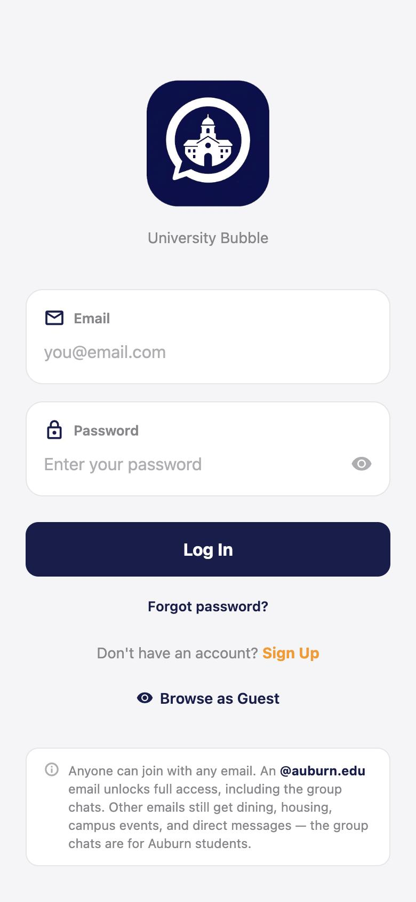
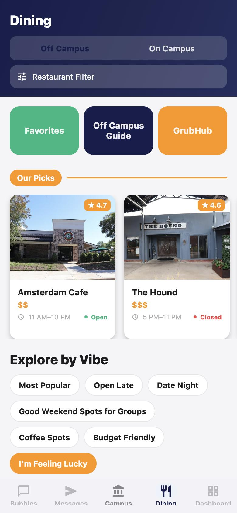
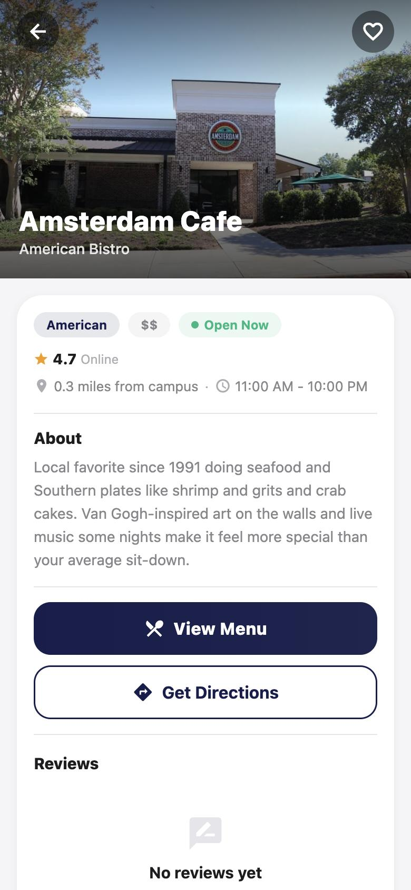
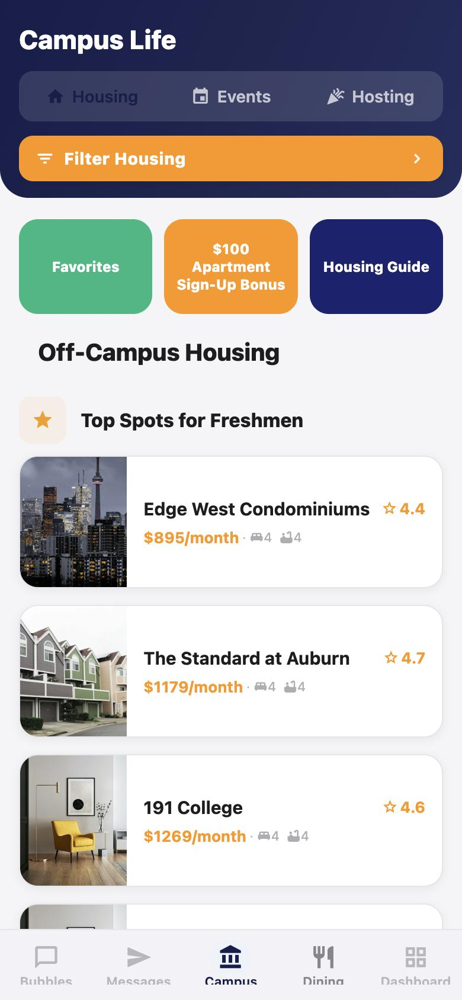

  

<h1 align="center">University Bubble</h1>

University Bubble is a campus social app for Auburn University students, with group chats, messaging, dining, housing and events in one place. I built it solo with React Native, Expo and Supabase for iOS and Android, and it's in beta on TestFlight.

The app is a private product, so its source code lives in a private repository. This page covers what it does, how it's built, and some of the problems I solved along the way.

## Screenshots

  
  
  
  

## What it does

- Bubbles are class and interest group chats with photos, polls, pinned messages, and a member list you can see before joining. Only verified `@auburn.edu` accounts can use them.
- Direct messages are real-time 1:1 chats with read tracking, exact unread badges, mute and push notifications.
- Dining covers 350+ on- and off-campus restaurants with live open/closed status, hours, filters like "Open Late" and "Budget Friendly", favorites, reviews, menus and directions.
- Campus life has about 70 off-campus apartments sorted by category, a housing guide, campus events and a study-spot guide.
- The whole UI is translated into 32 languages, and the language packs are lazy-loaded so startup stays fast.
- An in-app admin console edits restaurant and housing content live, moderates group chats and bans users, all without a redeploy.
- Guests can browse dining and campus content without an account.

## How it's built

The app is React Native 0.81 on Expo SDK 54, written in TypeScript, with Expo Router for file-based navigation, Reanimated, and SF Symbols on iOS or Material Icons on Android. Expo Notifications handles push, and Expo Updates ships JavaScript fixes over the air. Screens get their data through context providers backed by an offline stale-while-revalidate cache.

The backend is Supabase. That means Postgres with row-level security, 28 SQL migrations with triggers and RPCs, Realtime (Postgres changes and broadcast) for messages, unread counts and content updates, plus Storage, Auth, and Deno edge functions for email verification codes, password reset and push notification fan-out.

Builds go through EAS Build and Submit to TestFlight. Tests run on Jest (`jest-expo`), ESLint handles linting, and every database change is a migration in version control.

## Engineering highlights

### Security enforced on the server

- Login uses email-based two-factor verification. Codes come from a cryptographically secure generator, are stored only as SHA-256 hashes, and expire. Password-reset codes work the same way and are checked with a constant-time comparison.
- Every table has Postgres row-level security. Rules like "only Auburn students can post in group chats" and "banned users can't send messages" are enforced by database triggers, so a modified client can't get around them.
- Logins, sign-ups, messages and reviews are rate limited on the server, with hourly and daily caps.
- Admin roles come from a server-side allowlist, and clients can't write the role column.
- Inputs are sanitized and length-limited, and image uploads get magic-byte checks.

### Real-time messaging that stays correct

- Messages weren't arriving live, and pushes were going to accounts people had signed out of. The causes were an unmanaged realtime publication and a push-token table that let one device belong to many users. I fixed both with migrations and a "last sign-in wins" token model.
- Unread counts are computed on the server, with read markers that hold up under clock skew. Messages stay in order across optimistic sends, realtime events and pagination.
- Database triggers send push notifications through an edge function that re-reads the message from the database, so notification content can't be forged and replays are blocked.

### Performance

- The direct-message list went from 5 network round trips to 3 after I moved the joins into a single Postgres function.
- Stale-while-revalidate caching lets screens render right away on launch.
- Lazy-loading the translation packs took about 267 KB off the startup bundle.

### Shipping and testing

- I've shipped 20+ builds to TestFlight. JavaScript-only fixes go out over the air without App Store review.
- There are 92 unit tests. One is a guardrail test that scans every screen and fails the build if an admin-editable field is rendered without live-update support. That bug had shipped three times before the test existed.
- Code audits before release caught real bugs, like poll voting that a database policy was blocking and a member count that never updated.

## What I learned

Put the security in the database. Client checks are for user experience, and triggers and RLS are what actually protect the data.

Realtime systems fail quietly. A subscription can look connected and still deliver nothing, so everything the app depends on belongs in version control, Supabase dashboard settings included.

Write the test for the bug that keeps coming back. A 50-line guardrail test ended a whole category of regressions.
